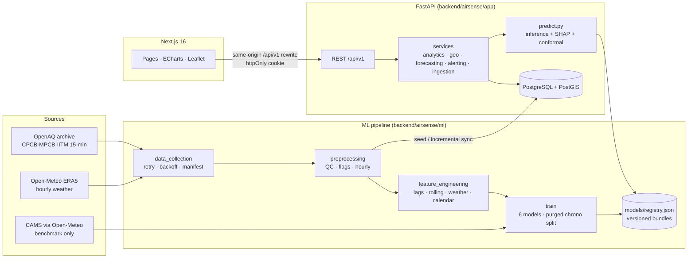

# AirSense

**Air-quality monitoring, exploratory analysis and 24-hour PM2.5 forecasting for Pune, India.**
A full-stack ML product: real CPCB/MPCB/IITM station data → reproducible cleaning pipeline → leakage-safe
multi-horizon XGBoost with calibrated uncertainty → FastAPI + PostGIS → Next.js analytics app.

> **Research question:** can historical air-quality measurements, temporal patterns and meteorology forecast
> short-term PM2.5 accurately and identify pollution hotspots?
> **Answer (hold-out test, Aug–Nov 2026):** yes. XGBoost beats persistence at **all 24 lead times**
> (mean MAE skill **+29.5%**, range +9% at 1 h to +40% at 16 h). It is **38% more accurate than the Copernicus CAMS model**
> at +24 h, and its 80% prediction intervals reach **77–82% empirical coverage**.

| | |
|---|---|
| **Data** | 4.0 M raw 15-minute readings · 10 stations · Feb 2025 – Nov 2026 · 113,899 valid hourly PM2.5 values |
| **Model** | 24 direct-horizon XGBoost models, conformal intervals, SHAP explanations, versioned registry |
| **Backend** | FastAPI · SQLAlchemy 2 · Alembic · PostgreSQL 16 + PostGIS (SQLite for local dev) · JWT auth |
| **Frontend** | Next.js 16 · React 19 · TypeScript · Tailwind 4 · ECharts · Leaflet · TanStack Query · Framer Motion |
| **Quality** | 45 backend tests · 22 frontend unit/component tests · 7 Playwright E2E journeys (desktop + mobile) · CI on GitHub Actions |

---

## Contents
1. [Features](#features) · 2. [Architecture](#architecture) · 3. [Results](#results) · 4. [Quick start](#quick-start) ·
5. [Environment](#environment) · 6. [Testing](#testing) · 7. [Deployment](#deployment) · 8. [Repository layout](#repository-layout) ·
9. [Limitations](#known-limitations) · 10. [Future work](#future-enhancements) · [Documentation index](#documentation)

## Features
| Area | What it does |
|---|---|
| **Overview dashboard** | City AQI gauge (CPCB bands), live pollutant panel, ERA5 conditions, 7-day history + 24 h forecast band, station network table with per-station forecast sparklines, recent alerts |
| **Historical analysis** | Auto-generated findings, multi-station trends (daily/monthly, gaps kept visible), seasonal bars with p90, diurnal profiles, weekday×hour heatmap, Spearman correlation matrix, box plots, station comparison against the 60 µg/m³ NAAQS, PM2.5 vs weather scatter with binned means; pollutant / period / station filters |
| **Forecasting** | 24 h forecast per station with an 80% interval, hourly exceedance probabilities for any threshold, a SHAP "why this forecast" view per lead time, the cleanest 2-hour window, and on-demand re-run |
| **Model Lab** | 6 models compared on the chronological hold-out (MAE/RMSE/R² by horizon), skill vs persistence, interval coverage, actual vs predicted, residuals, feature importance, alerting precision/recall, daily SARIMA track |
| **Geospatial** | Leaflet map of live PM2.5, a statistical hotspot layer and ranking, and nearest-station lookup from browser geolocation (PostGIS `<->` / `ST_Distance` in production) |
| **Alerts** | User rules (station, threshold, look-ahead, minimum confidence). They are evaluated against probabilistic forecasts and observations, de-duplicated per episode, and support read/unread, pagination and delete with confirmation |
| **Accounts** | Register/login (bcrypt + JWT in an httpOnly cookie), password reset with single-use hashed tokens, profile, preferences (default station, personal threshold, sensitive group, theme), account deletion |
| **Platform** | Landing page with a live forecast preview, a methodology page built from live API metadata, light/dark themes, responsive layout, skeleton loaders, toasts, empty and error states, keyboard focus rings, skip link |

Every number on screen comes from the API, which reads the database or runs the trained model. If a request fails, the UI shows the error with its request id. It never falls back to placeholder data.

## Architecture

More detail: [docs/ARCHITECTURE.md](docs/ARCHITECTURE.md) · ER diagram: [docs/DATABASE.md](docs/DATABASE.md)

## Results
Test window **1 Aug – 19 Nov 2026** (post-monsoon, Diwali, early winter), 8 stations, never seen in training or tuning.

| MAE (µg/m³) | +1 h | +6 h | +12 h | +24 h |
|---|---|---|---|---|
| Persistence | 5.89 | 16.33 | 18.57 | 13.51 |
| Seasonal naive (same hour yesterday) | 13.39 | 13.40 | 13.49 | 13.51 |
| Linear Regression | 6.11 | 12.10 | 12.61 | 12.14 |
| Random Forest | 5.49 | 11.21 | **11.98** | **11.47** |
| **XGBoost (deployed)** | **5.34** | **10.98** | 12.00 | 12.01 |
| CAMS global model (physics, ~40 km) | 19.30 | 19.31 | 19.47 | 19.51 |

* XGBoost R² is 0.86 at +1 h and 0.41–0.49 at +6 to +24 h. Persistence R² goes negative at 6–12 h.
* Random Forest is statistically indistinguishable from XGBoost. XGBoost was deployed because the 24-model bundle is 10 MB (vs hundreds of MB for RF), it handles missing values natively, and it gives exact SHAP values.
* SARIMA(1,0,1)(1,0,1,7) on daily means scored MAE 9.56 vs 8.48 for daily persistence. It **did not** beat the baseline and was not deployed.
* The biggest driver at +24 h is the current PM2.5 level, then its 24 h trend, surface pressure, PM10, recent maxima and season.

Figures: [`reports/figures`](reports/figures) · full tables: [`reports/model_results`](reports/model_results) · notebooks: [`notebooks/`](notebooks)

## Quick start
### Option A: Docker (PostgreSQL + PostGIS, API, web)
```bash
cp .env.example .env            # then set AIRSENSE_SECRET_KEY to a random 64-char string
docker compose up --build       # first boot migrates and seeds ~750k rows
# Web http://localhost:3000 · API docs http://localhost:8000/docs
```

### Option B: local (SQLite, no Docker)
Requirements: Python 3.12+, Node 22+.
```bash
# Backend
cd backend
python -m venv .venv && . .venv/Scripts/activate      # macOS/Linux: source .venv/bin/activate
pip install -r requirements-dev.txt
export PYTHONPATH=.                                     # PowerShell: $env:PYTHONPATH="."
python -m airsense.app.cli migrate
python -m airsense.app.cli seed                         # loads data/processed + weather (≈1 min)
python -m airsense.app.cli create-user --email you@example.com --name "You" --admin
uvicorn airsense.app.main:app --reload --port 8000

# Frontend (second terminal)
cd frontend
npm ci
npm run dev                                             # http://localhost:3000
```
> **Windows note:** keep the virtualenv on a short path (e.g. `C:\venvs\airsense`). pyarrow fails to load its DLLs from paths longer than 260 characters.

### Re-running the data science pipeline
```bash
cd backend && export PYTHONPATH=.
python -m airsense.ml.data_collection --discover --start 2025-02-01   # raw archive + weather + CAMS (~10 min)
python -m airsense.ml.preprocessing                                   # QC, hourly, coverage audit
python -m airsense.ml.eda                                             # 8 EDA figures + eda_summary.json
python -m airsense.ml.train                                           # 24 horizons, ~4 min, new model version
python -m airsense.app.cli seed                                       # reload DB; API picks up registry
```

## Environment
All configuration is environment-based (`AIRSENSE_` prefix). See [.env.example](.env.example).

| Variable | Purpose | Default |
|---|---|---|
| `AIRSENSE_ENV` | `development` / `test` / `production` (production refuses weak secrets and forces secure cookies) | development |
| `AIRSENSE_DATABASE_URL` | SQLAlchemy URL (`postgres://` URLs are normalised to psycopg) | sqlite:///airsense.db |
| `AIRSENSE_SECRET_KEY` | JWT signing key (≥32 chars in production) | dev placeholder |
| `AIRSENSE_CORS_ORIGINS` | comma-separated allowed origins | localhost:3000 |
| `AIRSENSE_RATE_LIMIT_DEFAULT` / `_AUTH` | slowapi limits | 120/min · 10/min |
| `AIRSENSE_ENABLE_SCHEDULER` | background incremental ingestion every `AIRSENSE_INGESTION_INTERVAL_HOURS` | false |
| `AIRSENSE_SMTP_*` | e-mail for password reset and alerts (logged when unset in development) | — |
| `BACKEND_URL` (frontend, build time) | where Next.js proxies `/api/v1` | http://127.0.0.1:8000 |
| `NEXT_PUBLIC_TILE_URL` (frontend) | map tile provider (OSM by default) | OSM |

## Testing
```bash
cd backend && pytest                       # 45 tests: ML pipeline, DB, API integration, auth, alerts, rate limiting
cd frontend && npm test                    # 22 Vitest + React Testing Library tests
cd frontend && npx playwright test         # 7 E2E journeys; needs API on :8000 and web on :3000
```
Strategy and coverage map: [docs/TESTING.md](docs/TESTING.md).

## Deployment
Render (Docker API + managed Postgres with PostGIS) plus Vercel (Next.js). Blueprint: [render.yaml](render.yaml). Step-by-step instructions: [docs/DEPLOYMENT.md](docs/DEPLOYMENT.md).
Health probes: `GET /health` (liveness) and `GET /health/ready` (database + active model).

**Status:** deployment configuration is complete and the production build passes locally. The app is **not yet deployed** because that needs the owner's Render/Vercel accounts (see DEPLOYMENT.md).

## Repository layout
```
AirSense/
├── backend/
│   ├── airsense/ml/        data_collection · preprocessing · feature_engineering · train · predict · evaluation · eda
│   ├── airsense/app/       FastAPI app: core/ (config, security, errors, logging, rate limit) · db/ · api/ · services/
│   ├── alembic/            migrations (PostGIS column + GiST/BRIN indexes on PostgreSQL)
│   ├── tests/              pytest suites
│   └── Dockerfile
├── frontend/               Next.js app (src/app pages, components, lib), Vitest + Playwright tests, Dockerfile
├── data/                   raw/ (gitignored, reproducible) · interim/ · processed/ · external/ (station catalog)
├── models/                 versioned model bundles + registry.json
├── notebooks/              01–05 executed analysis notebooks
├── reports/                figures/ · model_results/ · data_quality/ · eda_summary.json
├── docs/                   specifications and portfolio material
├── docker-compose.yml · render.yaml · .github/workflows/ci.yml
```

## Known limitations
* About 21 months of history: only one complete winter in training, and the test window has a stronger Diwali spike than training did.
* The public archive lags real time by roughly 3–4 days, so forecasts are issued from the latest *published* observation and labelled as such.
* Weather is ERA5 reanalysis (~25 km), not on-site. No numerical weather *forecasts* are used yet, so future meteorology is unknown to the model.
* OpenAQ unit labels for gases are inconsistent between stations. Gases are kept in CPCB reporting units and used only as secondary features.
* Ten monitors cannot resolve neighbourhood-level variation. Hotspots describe monitoring sites.
* The PostgreSQL/PostGIS path is exercised by CI and Docker. It has not been run on the author's development machine, which has no Docker.

## Future enhancements
NWP weather forecasts as features (Open-Meteo forecast API) · quantile/NGBoost models · fire-count and traffic covariates ·
more cities (the config is driven by bbox and station catalog) · low-cost sensor fusion with calibration ·
SMS/WhatsApp notifications · drift monitoring with scheduled retraining · per-station fine-tuning.

## Documentation
| Document | |
|---|---|
| [REQUIREMENTS.md](docs/REQUIREMENTS.md) | Project requirement specification |
| [ARCHITECTURE.md](docs/ARCHITECTURE.md) | Software architecture and key decisions |
| [DATABASE.md](docs/DATABASE.md) | Schema, ER diagram, indexes |
| [API.md](docs/API.md) | Endpoint reference (live OpenAPI at `/docs`) |
| [ML_PIPELINE.md](docs/ML_PIPELINE.md) | Data, features, models, evaluation |
| [DATASET.md](docs/DATASET.md) | Dataset card: sources, licences, provenance, QC |
| [UI_UX.md](docs/UI_UX.md) | Design system and page specifications |
| [TESTING.md](docs/TESTING.md) · [DEPLOYMENT.md](docs/DEPLOYMENT.md) · [ROADMAP.md](docs/ROADMAP.md) | |
| [PORTFOLIO.md](docs/PORTFOLIO.md) | Presentation outline, interview walkthrough, resume bullets |

Data © CPCB / MPCB / IITM via OpenAQ (CC BY 4.0) · Weather © Open-Meteo / ECMWF ERA5 (CC BY 4.0) · Map © OpenStreetMap contributors.
AirSense is a portfolio project and not an official air-quality advisory.
