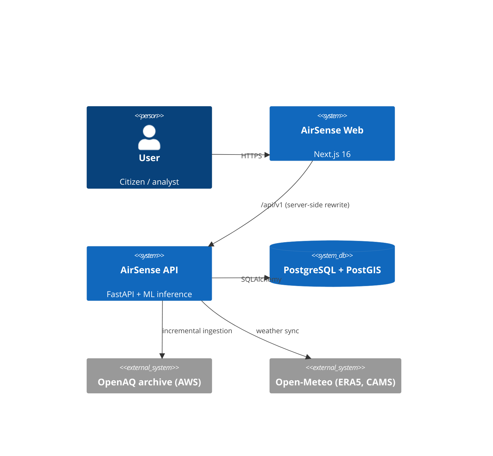
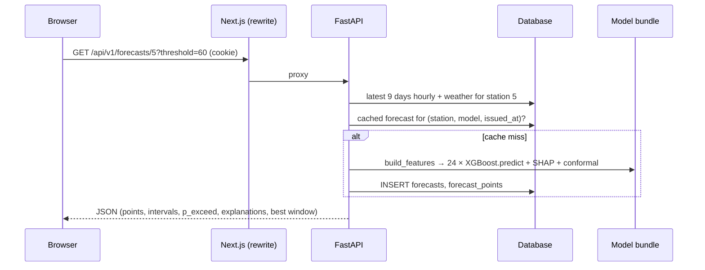

# Software Architecture

## 1. Context


## 2. Containers and responsibilities
| Layer | Tech | Responsibility |
|---|---|---|
| Web | Next.js 16 App Router, React 19, TS, Tailwind 4 | Pages, client data fetching (TanStack Query), charts (ECharts, tree-shaken), maps (Leaflet), auth gate (`src/proxy.ts`) |
| API | FastAPI, Pydantic v2 | Validation, auth, rate limits, error envelope, OpenAPI |
| Services | Python | Analytics (pandas), geo (PostGIS/haversine), forecasting orchestration, alerting, ingestion |
| ML | pandas, scikit-learn, XGBoost, statsmodels | Collection → QC → features → training → versioned bundle → inference |
| Data | PostgreSQL 16 + PostGIS (prod), SQLite (dev/test) | Normalised schema, migrations via Alembic |

Backend packages:
```
airsense/
├── ml/              # pure data science, no web dependencies
│   ├── data_collection.py  preprocessing.py  feature_engineering.py
│   ├── train.py  predict.py  evaluation.py  eda.py  paths.py
└── app/
    ├── core/        config · security · errors · logging · ratelimit
    ├── db/          models (ORM) · session
    ├── api/         auth · users · data (stations, air-quality, weather, analytics, geo, meta) · ml · alerts (+ ingestion)
    ├── services/    data · measurements · analytics · geo · forecasting · alerting · ingestion · notify
    ├── schemas.py   deps.py   main.py   cli.py
```

## 3. Request flow (forecast)


## 4. Key decisions (ADR summary)
| # | Decision | Why | Trade-off |
|---|---|---|---|
| 1 | **OpenAQ public S3 archive** instead of the v3 API | The v3 API needs a key; the archive is key-free, complete and versioned | ~3–4 day publication lag; station discovery scans an ID range |
| 2 | **Direct multi-horizon** (24 models) instead of recursive | No compounding error; each horizon tuned separately | 24 artefacts (10 MB total) |
| 3 | **Level vs delta target chosen per horizon on validation** | Trees can't extrapolate to Diwali-scale spikes; delta tracks them | Two fits per horizon at training time |
| 4 | **Normalised split-conformal intervals** | Distribution-free, cheap, widen in volatile periods, give exceedance probabilities | Marginal (not conditional) coverage guarantee |
| 5 | **XGBoost over RF** despite similar MAE | 10 MB vs hundreds of MB, native NaN handling, exact SHAP via `pred_contribs` | — |
| 6 | **SQLite locally, PostGIS in production** | Dev machine without Docker; one ORM, dialect-specific spatial path | PostGIS path validated by CI/Docker, not on the dev box |
| 7 | **Same-origin API via Next.js rewrites + httpOnly cookie** | No token in JS (XSS), no CORS in the browser, no API URL in the client bundle | Rewrites resolved at build (set `BACKEND_URL`) |
| 8 | **Cache Components disabled** in Next 16 | The app is an authenticated, client-fetched dashboard; PPR adds complexity without benefit | Static shells + client data |
| 9 | **Statistical hotspot ranking, not interpolation** | 10 monitors can't support kriging/IDW surfaces | Less visually dramatic |
| 10 | **Station-agnostic model** (no station one-hot) | Generalises to new stations or cities; 7-day mean encodes station baseline | Slightly less station-specific |

## 5. Cross-cutting concerns
* **Errors:** `AppError` hierarchy → `{"error": {code, message, details}, "request_id"}`. Validation errors are flattened per field. Unhandled exceptions are logged with a stack trace and return 500 without internals.
* **Logging:** JSON logs in production with request id, path, status and duration. Security headers are added in middleware.
* **Caching:** analytics frames are cached with a TTL plus single-flight locks, keyed by the latest successful ingestion run (new data invalidates automatically), and warmed at startup.
* **Background work:** ingestion through FastAPI `BackgroundTasks` (admin) or an opt-in scheduler thread. A process lock prevents overlapping runs.
* **Model lifecycle:** `train.py` writes `models/<version>/` and updates `registry.json`. The API mirrors the registry into `model_versions`. Admins can activate a version.
