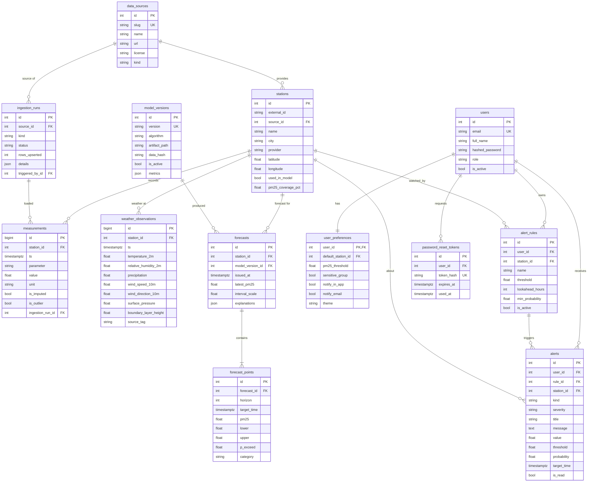

# Database Schema

Normalised (3NF) relational model managed by SQLAlchemy 2 + Alembic (`backend/alembic/versions/0001_initial_schema.py`).
On PostgreSQL the migration also enables **PostGIS**. It adds a generated `stations.geom geography(Point,4326)` column with a GiST
index, and a BRIN index on `measurements.ts` (small and well suited to append-only time series).

## ER diagram

## Constraints and indexes
| Table | Integrity | Indexes |
|---|---|---|
| measurements | `UNIQUE(station_id, parameter, ts)` (idempotent upserts) · `CHECK value >= 0` · `CHECK parameter IN (pm25…o3)` · FK cascade | `ix_measurement_param_ts`, BRIN(ts) on PG |
| stations | `UNIQUE(source_id, external_id)` · lat/lon range checks | GiST(geom) on PG |
| forecasts | `UNIQUE(station_id, model_version_id, issued_at)` (forecast cache) | |
| forecast_points | `UNIQUE(forecast_id, horizon)` · `CHECK horizon 1–72` · `CHECK p_exceed 0–1` | forecast_id |
| alerts | `UNIQUE(user_id, station_id, kind, target_time)` · kind check | (user_id, created_at) |
| alert_rules | threshold 0–500 · look-ahead 1–24 · probability 0–1 | user_id |
| users / prefs | unique email · role check · threshold & theme checks | email |

## Notes
* **Long format** for measurements (`parameter` column) keeps the schema stable when pollutants are added. Analytics pivot it in pandas.
* All timestamps are UTC. `UTCDateTime` restores tzinfo on SQLite, which drops it. The UI renders IST.
* Raw 15-minute files are not stored in the DB. They live in `data/raw` with a provenance manifest. The DB holds quality-controlled hourly data plus flags.
* Volumes after seed: ~750 k measurement + weather rows (≈100 MB in SQLite).
