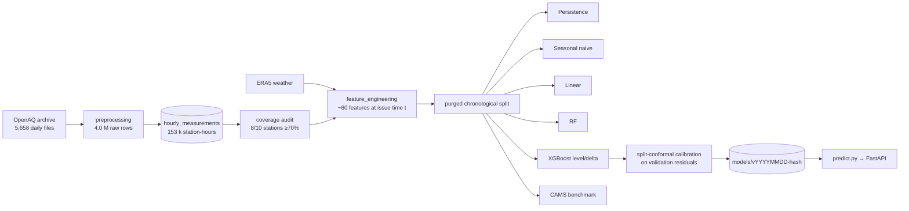

# ML Pipeline



## 1. Data
| Source | Use | Resolution |
|---|---|---|
| OpenAQ archive (CPCB/MPCB/IITM) | PM2.5, PM10, NO₂, SO₂, CO, O₃ observations | 15 min → hourly |
| Open-Meteo ERA5 | temperature, RH, precipitation, wind, pressure, boundary-layer height | hourly, at each station coordinate |
| CAMS global (Open-Meteo) | **benchmark only**, never a feature or an observation | hourly, ~0.4° grid |

Coverage audit (hourly PM2.5 completeness): Panchawati Pashan 90.5%, Thergaon 85.4%, Savta Mali Nagar 81.9%, Park Street Wakad 79.2%,
Bhumkar Nagar 76.5%, Gavalinagar 76.0%, Katraj Dairy 73.8%, Bhosari 70.9% → **used for training**. Dhankawadi 61.8% and SPPU 47.7% are shown in the app but excluded from training.
Hourly coverage is good enough, so the PS's daily fallback was not needed.

## 2. Cleaning (see `reports/data_quality/quality_log.csv`)
| Check | Count | Action |
|---|---|---|
| Out of physical bounds (e.g. PM2.5 36,216 µg/m³) | 46,975 readings | removed |
| Flat-line ≥ 6 h (stuck sensor) | 124,234 readings (mostly gases/met) | removed |
| Hours with < 2 of 4 valid slots | 63,836 hours | set NaN |
| Robust z > 6 on a 24 h window | 4,651 hours | **flagged, kept** |
| PM2.5 > PM10 × 1.05 | 1,244 hours | flagged, kept |
| Gaps ≤ 2 h interpolated (PM2.5 only) | 6,184 hours | marked; never used as targets |

## 3. Features (at issue time *t*; target = PM2.5 at *t + h*)
* **PM2.5 history:** current value, lags 1, 2, 3, 6, 12, 24, 48 and 168 h; rolling mean/std over 3, 6, 12 and 24 h; 24 h max/min; 7-day mean; 1 h and 24 h differences; missing count over 24 h.
* **Other pollutants:** current PM10, NO₂, SO₂, CO and O₃ plus their 24 h means; PM2.5/PM10 ratio.
* **Weather (≤ t only):** temperature, RH, precipitation, wind u/v, pressure, boundary-layer height; 24 h rain, mean BLH, mean RH, temperature change.
* **Calendar:** issue-time hour (sin/cos), weekday, weekend, month (sin/cos), IMD season, Diwali window. Target-time hour, weekday and festival are known in advance.
* **Station-agnostic:** there is no station ID. The 7-day mean encodes the site's baseline.
* **Leakage guard:** `test_features_do_not_use_future_values` perturbs every value after *t* and asserts that the features at *t* are unchanged.

## 4. Splits (UTC, purged)
| Split | Window | Purge rule |
|---|---|---|
| Train | 18 Feb 2025 – 31 Mar 2026 | drop rows whose **target** falls ≥ 1 Apr 2026 |
| Validation | 1 Apr – 31 Jul 2026 | used for early stopping, target-mode choice and conformal calibration |
| Test | 1 Aug – 19 Nov 2026 | touched once; final models are refit on train + val |

## 5. Models
* **Persistence** and **seasonal naive** are the baselines.
* **Linear regression:** median impute, standardise, OLS on the delta target.
* **Random forest:** 150 trees, depth 20, min leaf 5, 50% features, 40% bootstrap. Evaluated at 1/3/6/12/24 h only, for cost and artefact size.
* **XGBoost:** hist, depth 6, η 0.03, subsample 0.8, colsample 0.7, early stopping (100) on validation MAE. **Target mode** is chosen per horizon on validation: *delta* (y − current) wins at h = 1, 18 and 21–24, *level* elsewhere. Refit on train + val with 1.1 × best iterations.
* **SARIMA(1,0,1)(1,0,1,7)** on daily means as a separate daily track, compared with daily persistence.
* **CAMS:** the physics-based forecast at the station's grid cell.

## 6. Uncertainty and alerts
Normalised split-conformal: score = (y − ŷ) / (σ₂₄ₕ + 5), where σ₂₄ₕ is the recent PM2.5 standard deviation. Validation-score quantiles give the
80% interval and **P(PM2.5 > threshold) = mean(ŷ + q·scale > threshold)** over the 101 stored quantiles. Test coverage is 76.6–82.2% across horizons.

## 7. Results (test set)
See the README table. XGBoost skill vs persistence is +9.4% (1 h) to +39.7% (16 h), mean +29.5%. Alerting at 60 µg/m³ (+24 h) has precision 75% and recall 71%,
vs CAMS at 47% / 15%. The top features are current PM2.5, 24 h trend, surface pressure, current PM10 and short-term maxima.

## 8. Versioning and serving
`models/<version>/best_model.pkl` is a joblib bundle holding the 24 boosters, linear models, conformal quantiles, feature lists, target modes, split dates,
data hash, git commit and library versions. `metadata.json`, `metrics.json` and `test_predictions_h{1,3,6,12,24}.parquet` sit alongside it, and `registry.json` names the active version.
`predict.forecast_station()` rebuilds the features with the **same function** used in training (train/serve parity), so the API never serves hard-coded predictions.

## 9. Reproduce
```bash
python -m airsense.ml.data_collection --discover --start 2025-02-01
python -m airsense.ml.preprocessing && python -m airsense.ml.eda && python -m airsense.ml.train
```
